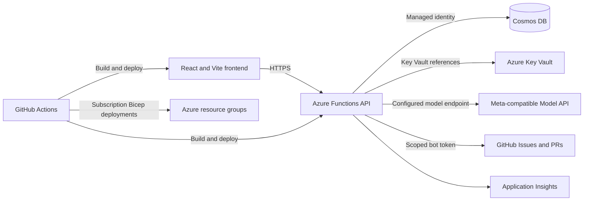

# AccessiWeb Engine

AccessiWeb Engine is a TypeScript monorepo starter for AI-assisted accessibility audits and reviewable GitHub remediations.

## Architecture



The Azure resources and CI/CD workflows are defined under `infra/bicep` and `.github/workflows`. See [Platform Engineering](docs/PLATFORM_ENGINEERING.md), [Security](SECURITY.md), [Privacy](PRIVACY.md), and the [Hackathon submission draft](docs/HACKATHON_SUBMISSION.md) for deployment and project details.

## Experiences

- **Web URL audit:** Fetches public HTML, optionally interprets a user-provided screenshot with Muse Spark, produces a structured WCAG report, and can open a GitHub issue.
- **Public repository audit:** Reads up to **60 supported source files** and **1.5 MB (1,500,000 bytes)** combined from a public GitHub repository and reports file/line findings. Larger repositories are rejected; analyze a smaller repository or its deployed web page instead.
- **Private remediation preview:** Requires an Entra ID B2C token, the global `FEATURE_ENABLE_AUTO_PR_PREVIEW` switch, the user's Cosmos DB preview flag, and an allowlisted repository. The API first returns the exact patch plan for review; a short-lived server-signed approval is required to publish that unchanged plan in a verified bot-owned public fork. It never pushes to the upstream repository.

Reports are stored in Cosmos DB; raw HTML and source file contents are only passed through memory for analysis. GitHub issue content is rendered server-side from a saved repository report. Generated changes are not published until a user reviews and approves the exact plan, and are never merged automatically.

## Local setup

Requirements: Node.js 22+, npm 10+, and Azure Functions Core Tools v4 to run the API locally.

```sh
npm install
cp apps/web/.env.example apps/web/.env
cp apps/api/local.settings.example.json apps/api/local.settings.json
npm run typecheck
npm test
npx playwright install chromium
npm run test:e2e
npm run build
```

Run the frontend with `npm run dev`. Run the API with `npm run start:api` after building the workspace. Configure secrets and service endpoints in the API's local settings or deployment environment; only the `VITE_*` settings belong in the browser app. Never place Meta, GitHub, or Cosmos credentials in Vite environment variables.

The engine's runtime syntax verification uses the `typescript-compiler` npm alias pinned to TypeScript 6, which still exposes the JavaScript compiler API. The alias keeps source, locally compiled, and packaged execution separate from the TypeScript 7 development-only build compiler.

For Meta-hosted scans, set `META_API_BASE_URL=https://api.meta.ai/v1`, `META_API_KEY` to a server-side Meta API key, and `META_MUSE_CODE_MODEL=muse-spark-1.3` (the default). The existing `META_MUSE_CODE_MODEL` setting selects the model for audits, screenshot interpretation, and remediation; `muse-code` is not a documented Meta model ID. The client also accepts the official root `https://api.meta.ai` and adds `/v1`, without changing custom proxy/partner path prefixes. Requests use `POST /v1/chat/completions`, bearer authentication, and JSON Schema response formatting, as described in Meta's [API reference](https://dev.meta.ai/docs/api-reference), [authentication](https://dev.meta.ai/docs/authentication), and [structured output](https://dev.meta.ai/docs/structured-output) documentation.

Optional screenshots use the same model's [image understanding](https://dev.meta.ai/docs/image-understanding) capability and return estimated element bounds, not pixel-accurate masks. `META_SAM_MODEL` is no longer used: SAM 3.1 uses the separate Responses API and does not produce this chat-style accessibility report. Custom audit models must support structured JSON and, for screenshots, image inputs. The optional audio/image helpers still require separately compatible model capabilities via `META_MUSE_WONDER_MODEL` and `META_MUSE_IMAGE_MODEL`; a working scan does not establish support for those helpers.

Set `META_ANALYSIS_PROVIDER=open-weights` with `META_MUSE_SPARK_OPEN_URL`, the partner's dedicated `META_MUSE_SPARK_OPEN_API_KEY`, and `META_MUSE_SPARK_OPEN_MODEL` to route repository audits to the configured open-weights endpoint; the Meta API key is not used for this route. GitHub issue and remediation writes require `GITHUB_BOT_TOKEN` and an explicit comma-separated `GITHUB_ISSUE_ALLOWED_REPOSITORIES` allowlist using `owner/repo` entries. Issues are created only from saved repository scans and limited to five per repository per hour using Cosmos-backed quotas. Public scans and generated audio/images share a 10/hour per-IP quota; authenticated scans and generated audio/images share a 30/hour per-user quota. Preview remediations have a separate 5/hour per-user quota through the Cosmos `rateLimits` container. Cosmos uses `COSMOS_DB_ENDPOINT` and managed identity outside local development; set `COSMOS_DB_CONNECTION_STRING` for local development. The database is `accessiweb-db`, and its `scans`, `remediations`, `users`, and `rateLimits` containers are initialized on first use.

Entra ID B2C configuration uses `ENTRA_B2C_TENANT_NAME`, `ENTRA_B2C_SIGNUP_SIGNIN_POLICY`, `ENTRA_B2C_CLIENT_ID`, and the exact expected `ENTRA_B2C_ISSUER`. The frontend also needs the corresponding `VITE_ENTRA_B2C_*` settings, an optional `VITE_ENTRA_B2C_PROFILE_EDIT_POLICY`, and an API scope if the API is registered as a protected resource. Configure `FEATURE_ENABLE_AUTO_PR_PREVIEW=true` only for an explicitly enabled preview deployment. `POST /api/v1/users/me/preview-access` requires a valid bearer token and either a server-side `META_PREVIEW_INVITE_CODE` or `previewAccessApproved: true` on the user's Cosmos DB profile. If unset, `META-HACKATHON-2026` is accepted only when `APP_ENV`/`NODE_ENV` is not production; production has no default invite code. The older `/api/v1/preview/unlock` route remains as an alias.

## API routes

- `POST /api/v1/scans/web`
- `POST /api/v1/scans/repo`
- `GET /api/v1/scans/{scanId}/badge.svg`
- `POST /api/v1/scans/audio-preview`
- `POST /api/v1/images/accessibility-placeholder`
- `POST /api/v1/github/issues`
- `GET /api/v1/users/me`
- `DELETE /api/v1/users/me/data`
- `POST /api/v1/users/me/preview-access`
- `POST /api/v1/remediate/pull-request`
- `GET /api/v1/health` (liveness only; it does not check dependencies)

`POST /api/v1/github/issues` accepts a saved repository scan's `scanId`; issue title and body are composed from the stored report on the server. `POST /api/v1/remediate/pull-request` first prepares and returns a `planId` and plan for review; send that exact `approvedPlan`, `planId`, `approvedPatchHash`, and `approvalToken` in a second request to publish. The approval is user/repository-bound and expires after ten minutes.

The web scanner rejects non-public destinations, revalidates and pins every redirect, accepts HTML up to **5 MB (5,000,000 bytes)** with a **15-second timeout per target request** and at most **3 redirects**, and never executes the target page. This limit applies to the HTML document, including inline content, not the total website download size: linked images, JavaScript, fonts, and stylesheets are not downloaded. Its automated baseline is static HTML inspection, not a rendered browser audit. Screenshots are optional and supplied by the user; they are not persisted. Screenshot bounds are raw image pixels; without CSS viewport/DPR metadata, the engine does not claim WCAG CSS-pixel target-size conformance.

Web AI analysis has a separate **120-second deadline**, shared by screenshot interpretation, HTML analysis, and transient retries. Script elements, comments, and embedded data URLs are removed from the model snapshot without rewriting the remaining source. Only the first **100,000 remaining HTML characters** are sent for AI review; longer snapshots receive an explicit partial-review notice in the saved report summary. Baseline counts cover the fetched source, with heading-level samples bounded to 100 entries. The model never receives the full raw 5 MB document. See [scan troubleshooting](docs/PLATFORM_ENGINEERING.md#scan-limits-and-troubleshooting) for distinguishing page-fetch failures, AI failures, and gateway errors.

Repository analysis (including remediation preview) allows at most **60 HTML/HTM, JS/JSX, TS/TSX, Vue, Svelte, or CSS files** totaling **1.5 MB (1,500,000 UTF-8 bytes)** on the selected branch (the default branch if omitted). Other extensions do not count. GitHub-truncated file trees are rejected, and exceeding either limit returns HTTP 413 rather than a partial audit. Only the first **20,000 characters per file** are sent for AI review, so reports do not cover the remainder of longer files. Use a smaller public repository or scan its deployed web page when these limits are exceeded.

The report Markdown includes an embeddable score badge backed by the public SVG route. Browser tests capture full-page screenshots for all public routes and a mobile workspace viewport, and run axe-core against WCAG 2.2 A/AA/AAA tags. The remediation API persists workflow states (`ingest`, `audit`, `synthesize_patch`, `verify`, `document`, `submit_pr`, `complete` or `failed`) in Cosmos DB; it remains a synchronous request rather than a background job API. Successful PRs include `ACCESSIBILITY_REMEDIATION_REPORT.md` in the repository root.

## Scope and deployment

### Environment variables

| Variable | Runtime | Purpose |
| --- | --- | --- |
| `META_API_KEY`, `META_API_BASE_URL` | API | Server-side credentials and API base URL (`https://api.meta.ai/v1` for Meta) |
| `META_MUSE_CODE_MODEL` | API | Audit, screenshot, and remediation model; defaults to `muse-spark-1.3` |
| `META_MUSE_WONDER_MODEL`, `META_MUSE_IMAGE_MODEL` | API | Optional audio/image helper model identifiers; require compatible endpoints |
| `META_ANALYSIS_PROVIDER`, `META_MUSE_SPARK_OPEN_URL` | API | Optional repository-audit open-weights route |
| `META_MUSE_SPARK_OPEN_API_KEY`, `META_MUSE_SPARK_OPEN_MODEL` | API | Dedicated partner credentials and model identifier; never reuse the Meta API key |
| `GITHUB_BOT_TOKEN`, `GITHUB_ISSUE_ALLOWED_REPOSITORIES` | API | GitHub write integration and explicit issue allowlist |
| `COSMOS_DB_ENDPOINT` | API | Cosmos endpoint; deployed apps use their system-assigned identity |
| `COSMOS_DB_CONNECTION_STRING` | API local development only | Local Cosmos connection-string fallback |
| `ENTRA_B2C_TENANT_NAME`, `ENTRA_B2C_SIGNUP_SIGNIN_POLICY`, `ENTRA_B2C_CLIENT_ID`, `ENTRA_B2C_ISSUER` | API | JWT validation and B2C sign-in configuration |
| `FEATURE_ENABLE_AUTO_PR_PREVIEW`, `META_ALLOW_AUTONOMOUS_REMEDIATION`, `META_PREVIEW_INVITE_CODE` | API | The global preview gate also controls the autonomous-remediation safety opt-in; local runs default to disabled. The optional invite must not be exposed to the browser |
| `VITE_API_BASE_URL` | Frontend build | API base URL; deployment workflows set this from Bicep output |
| `VITE_ENTRA_B2C_TENANT_NAME`, `VITE_ENTRA_B2C_CLIENT_ID`, `VITE_ENTRA_B2C_SIGNUP_SIGNIN_POLICY`, `VITE_ENTRA_B2C_PROFILE_EDIT_POLICY`, `VITE_ENTRA_B2C_REDIRECT_URI`, `VITE_ENTRA_B2C_API_SCOPE` | Frontend build | Public identity-provider configuration only |

Production deployment still requires configuring Azure credentials, Entra B2C, Meta/GitHub permissions, GitHub environment protection, retention operations, and validating model endpoint compatibility. Review each generated PR before merging; see the linked platform, security, and privacy documentation.

Deployment workflows publish the actual Static Web App deployment URL in the run summary and GitHub environment link; PR comments use that same preview URL, not the default hostname. Each Function allows its own default frontend origin and actual deployed origin, with CORS preflight verification for PR, staging, QA, and production. See the platform guide for scan-failure troubleshooting.
